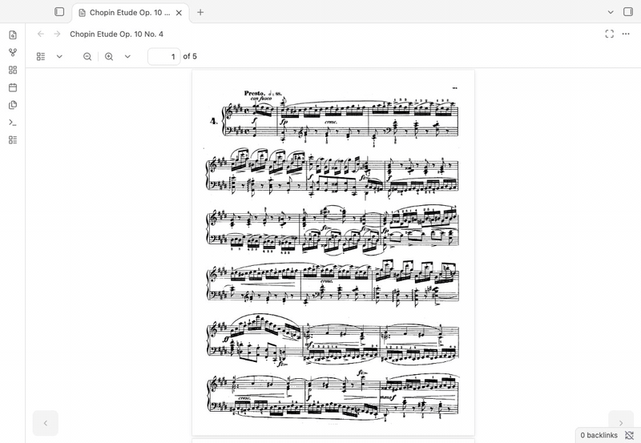

# Page Turner

Turn PDFs in Obsidian like sheet music — tap, swipe, or pedal.

[](https://github.com/JunHCha/obsidian-page-turner/stargazers)
[](https://github.com/JunHCha/obsidian-page-turner/actions/workflows/ci.yml)




<p align="center">
  <b>Was this what you needed?</b> Leave a star so other musicians can find it too.<br>
  <a href="https://github.com/JunHCha/obsidian-page-turner"></a>
</p>

## Features

- 👆 **Tap zones:** Tap a PDF's left or right edge to turn a page.
- 👈 **Swipe:** Swipe from the PDF page to turn; zoomed pages still pan.
- 🎹 **Keys and pedals:** Navigate with keyboard keys or Bluetooth pedals that send them.
- ⛶ **Focus mode:** Expand one PDF over the workspace.
- 📐 **Fit and snap:** Fit whole pages and align scrolling to page tops.
- ◀️ **On-screen buttons:** Use previous and next controls over the PDF.

## Install

- **Community plugins:** When listed, search for **Page Turner**, then install and enable it.
- **BRAT:** Add this beta plugin repository:

  ```text
  JunHCha/obsidian-page-turner
  ```

- **Manual:** Copy a release's `main.js`, `manifest.json`, and `styles.css` to `<vault>/.obsidian/plugins/page-turner/`, restart Obsidian, then enable the plugin.

## Use

Tap the PDF's left edge for the previous page or right edge for the next; the middle keeps default PDF behavior. Swipe left for next or right for previous, starting on the page.

| Action | Keyboard or pedal keys |
| --- | --- |
| Next page | `ArrowRight`, `ArrowDown`, `PageDown`, `Space` |
| Previous page | `ArrowLeft`, `ArrowUp`, `PageUp`, `Shift+Space` |

Keys work when a PDF is active and focus is outside editable controls. Pedals must send one of the keys above.

**Commands:** Next page · Previous page · Toggle page turner · Toggle focus mode. Find them in the command palette; none has a default hotkey.

<details>
<summary>Settings</summary>

| Setting | Default | What it does |
| --- | --- | --- |
| Enable page turner | `true` | Enables or disables all Page Turner behavior. |
| Tap to turn pages | `true` | Turns pages with short taps or clicks in side zones. |
| Tap zone width | `33` | Sets each side zone to 10–45% of the page width. |
| Swipe to turn pages | `true` | Turns pages with swipes starting on a PDF page. |
| Show page turn buttons | `true` | Shows previous and next buttons over the PDF. |
| Fit page to screen | `true` | Fits pages when the PDF opens or the viewer resizes. |
| Snap scrolling to pages | `true` | Aligns scrolling to page tops when the page fits. |
| Turn pages with keys and pedals | `true` | Enables supported keys and Bluetooth pedals. |

</details>

## Compatibility

Desktop, iOS, and Android; Obsidian 1.5.0 or later. Page Turner relies on Obsidian's internal pdf.js viewer, which may change with Obsidian updates.

## Feedback

Something broken or missing? [Report a bug](https://github.com/JunHCha/obsidian-page-turner/issues/new?template=bug_report.yml) · [Request a feature](https://github.com/JunHCha/obsidian-page-turner/issues/new?template=feature_request.yml)

[Contributing](CONTRIBUTING.md) · [MIT License](LICENSE)
